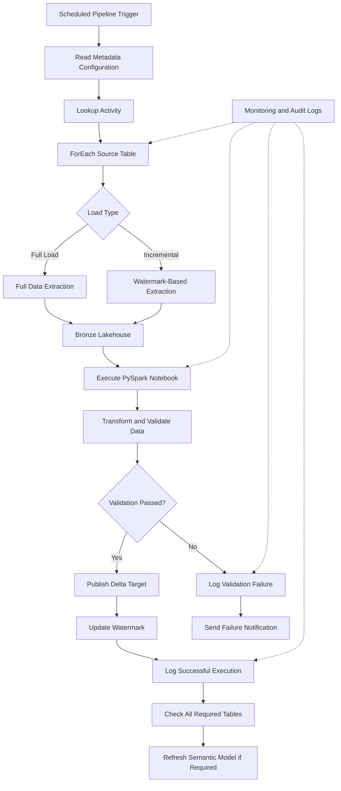
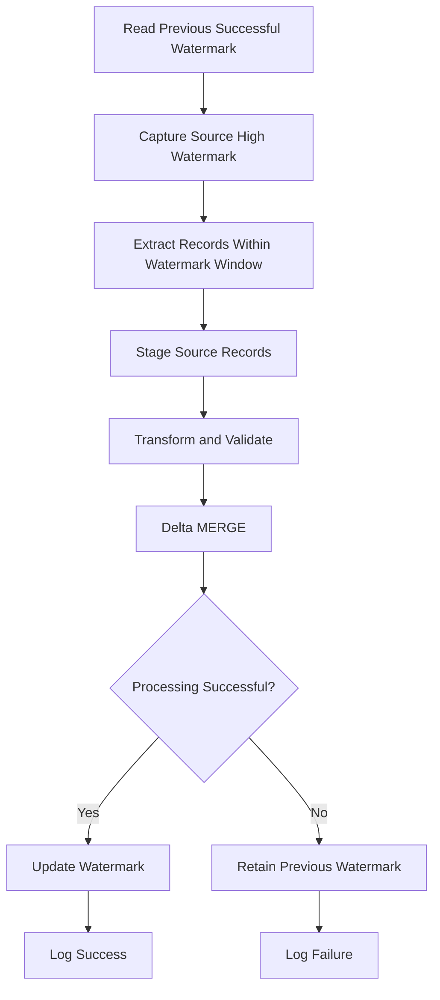
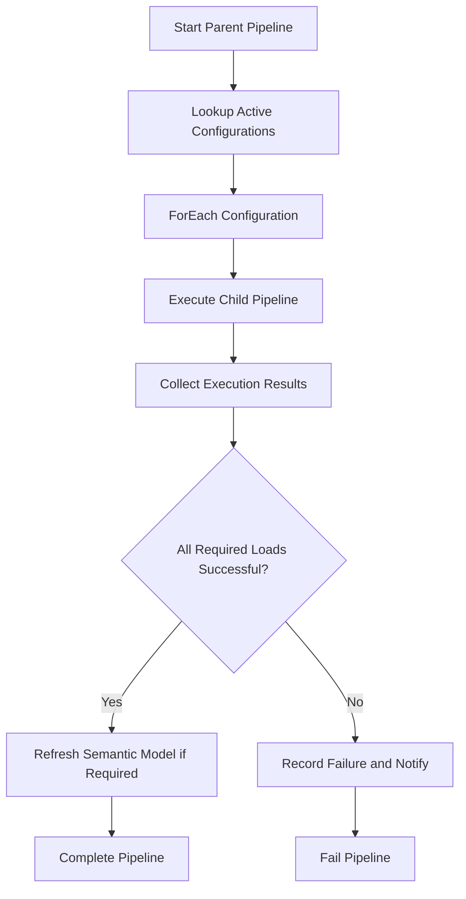
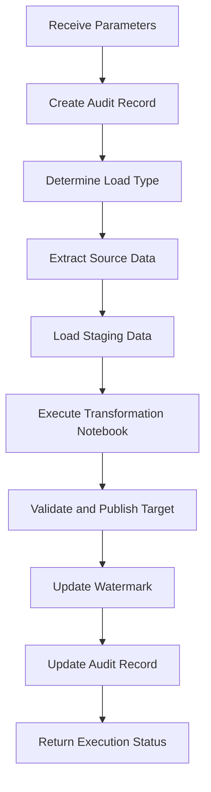
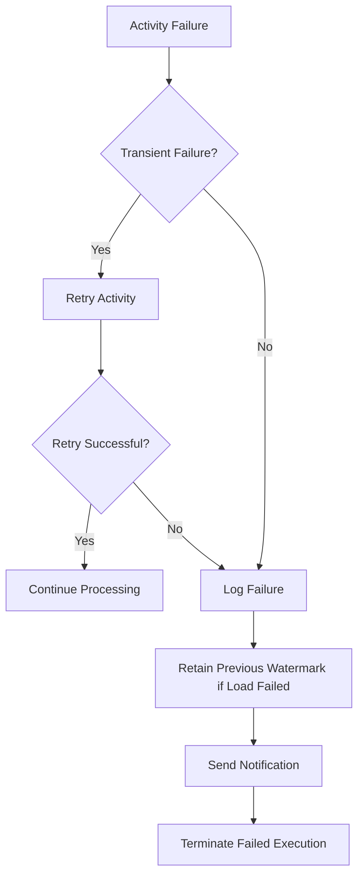
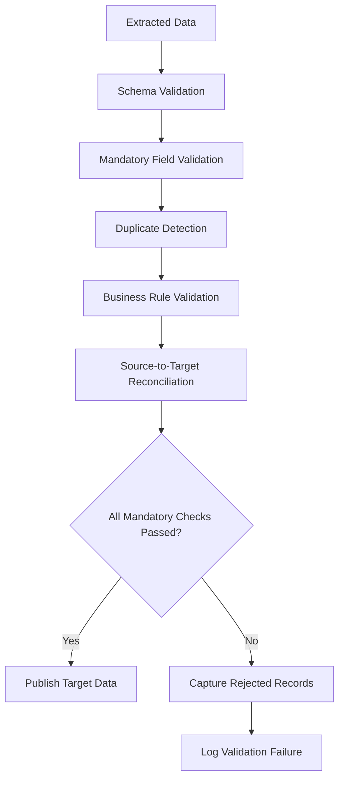

# Fabric Pipeline Automation

### Metadata-Driven Data Engineering & Automated ETL Framework


---

## Project Overview

This project demonstrates an automated data engineering
framework developed using Microsoft Fabric to streamline
recurring data ingestion, transformation, validation and
reporting workflows.

The solution uses metadata-driven pipelines, parameterized
activities, PySpark notebooks, Delta tables and automated
monitoring to support scalable and reliable data processing.

The framework is designed to reduce manual intervention,
standardize ETL processes, improve operational reliability
and ensure timely availability of business-ready data.

---

## Business Impact

The solution is designed to support:

- Reduced dependency on manual ETL execution.
- Improved reliability of recurring data workflows.
- Automated daily, weekly and monthly data processing.
- Reduced unnecessary full data loads.
- Improved visibility into pipeline execution status.
- Faster identification of processing failures.
- Standardized data validation and reconciliation.
- Reusable pipelines across multiple source tables.
- Improved scalability of data engineering processes.
- Timely availability of analytical datasets.
- Reduced maintenance effort through reusable components.

---

## Problem Statement

Traditional data processing environments often rely on
manual execution of SQL scripts, stored procedures,
data transformations and reporting refreshes.

As the number of data sources and analytical tables
increases, managing individual workflows becomes
time-consuming and difficult to scale.

Key challenges include:

- Manual execution of recurring ETL processes.
- Duplicate pipeline development for multiple tables.
- Delays in data availability.
- Unnecessary full data refreshes.
- Limited visibility into processing failures.
- Inconsistent data validation processes.
- Difficulty tracking historical execution status.
- Limited automated recovery mechanisms.
- Dependency on manual troubleshooting.
- Increased operational maintenance effort.

---

## Business Objectives

- Develop a reusable pipeline automation framework.
- Automate source-to-destination data processing.
- Implement metadata-driven pipeline execution.
- Enable dynamic processing of multiple source tables.
- Implement incremental data loading.
- Automate PySpark notebook execution.
- Establish pipeline dependencies.
- Implement automated data quality checks.
- Develop centralized audit logging.
- Configure retry and error-handling mechanisms.
- Monitor pipeline performance and reliability.
- Automate downstream reporting refreshes where required.

---

## Data Overview

### Data Sources

- SQL Server databases
- Relational transactional systems
- CSV and Excel files
- Financial transaction data
- Operational data
- Customer and employee master data
- Reference and lookup tables
- Historical analytical datasets

### Data Processing Categories

| Category | Description |
|---|---|
| Master Data | Customer, employee and organizational information |
| Transaction Data | Financial and operational transactions |
| Reference Data | Standardized lookup and classification data |
| Historical Data | Historical reporting and analytical records |
| Metadata | Pipeline configuration and processing rules |
| Audit Data | Pipeline execution and validation information |

### Supported Load Types

| Load Type | Description |
|---|---|
| Full Load | Complete replacement or rebuilding of a target dataset |
| Incremental Load | Processing new and modified source records |
| Append Load | Adding new records to an existing dataset |
| Upsert Load | Inserting new records and updating existing records |
| Historical Load | Processing historical reporting periods |
| Reprocessing | Re-executing a failed or selected processing window |

---

## Solution Architecture



---

## Technology Stack

| Technology | Purpose |
|---|---|
| Microsoft Fabric | Unified data engineering platform |
| Fabric Data Factory | Pipeline development and orchestration |
| Dataflows Gen2 | Low-code data transformation |
| OneLake | Centralized data storage |
| Fabric Lakehouse | Raw and transformed data management |
| PySpark | Distributed data transformation |
| Python | Automation and validation |
| SQL | Metadata management and source extraction |
| Delta Lake | Reliable transactional data storage |
| Power BI | Downstream analytical reporting |
| GitHub | Version control and documentation |

---

## Metadata-Driven Pipeline Framework

Instead of developing separate pipelines for every
source table, the framework uses configuration-driven
processing.

A centralized metadata table defines the processing
requirements for each source object.

The pipeline reads the configuration dynamically and
executes the appropriate ingestion and transformation
activities.

### Benefits

- Reusable pipeline architecture.
- Reduced duplicate development effort.
- Simplified onboarding of new source tables.
- Centralized processing configuration.
- Improved maintainability.
- Flexible full and incremental loading.
- Consistent validation and monitoring.

### Metadata Configuration Table

| Column | Description |
|---|---|
| ConfigID | Unique configuration identifier |
| SourceSystem | Name of the source system |
| SourceSchema | Source database schema |
| SourceTable | Source table name |
| TargetTable | Destination table name |
| LoadType | Full or incremental processing |
| PrimaryKey | Business key used for upsert operations |
| WatermarkColumn | Source modification timestamp column |
| LastWatermark | Latest successful processing watermark |
| NotebookName | Transformation notebook |
| ExecutionOrder | Processing priority |
| IsActive | Indicates whether processing is enabled |

---

## Sample Metadata Table Implementation

The following example uses a SQL Server control database.

```sql
CREATE TABLE PipelineConfiguration
(
    ConfigID INT IDENTITY(1,1) PRIMARY KEY,

    SourceSystem VARCHAR(100) NOT NULL,
    SourceSchema VARCHAR(100) NOT NULL,
    SourceTable VARCHAR(100) NOT NULL,

    TargetTable VARCHAR(100) NOT NULL,

    LoadType VARCHAR(20) NOT NULL,

    PrimaryKey VARCHAR(200),

    WatermarkColumn VARCHAR(100),
    LastWatermark DATETIME2,

    NotebookName VARCHAR(200),

    ExecutionOrder INT DEFAULT 1,

    IsActive BIT DEFAULT 1,

    CreatedDate DATETIME2 DEFAULT SYSUTCDATETIME(),

    CONSTRAINT CK_Pipeline_LoadType
        CHECK (LoadType IN ('Full', 'Incremental'))
);
```

### Sample Configuration Records

```sql
INSERT INTO PipelineConfiguration
(
    SourceSystem,
    SourceSchema,
    SourceTable,
    TargetTable,
    LoadType,
    PrimaryKey,
    WatermarkColumn,
    LastWatermark,
    NotebookName,
    ExecutionOrder
)
VALUES
(
    'SQLServer',
    'dbo',
    'Customers',
    'silver_customers',
    'Incremental',
    'CustomerID',
    'ModifiedDate',
    '2026-01-01',
    'customer_transformation',
    1
),
(
    'SQLServer',
    'dbo',
    'Transactions',
    'silver_transactions',
    'Incremental',
    'TransactionID',
    'ModifiedDate',
    '2026-01-01',
    'transaction_transformation',
    2
);
```

### Retrieve Active Configurations

```sql
SELECT
    ConfigID,
    SourceSystem,
    SourceSchema,
    SourceTable,
    TargetTable,
    LoadType,
    PrimaryKey,
    WatermarkColumn,
    LastWatermark,
    NotebookName,
    ExecutionOrder
FROM PipelineConfiguration
WHERE IsActive = 1
ORDER BY ExecutionOrder, ConfigID;
```

The Lookup activity retrieves the active configuration
records for dynamic pipeline execution.

---

## Pipeline Activities

| Activity | Purpose |
|---|---|
| Lookup | Retrieve metadata configuration |
| ForEach | Iterate through configured source tables |
| If Condition | Determine full or incremental load |
| Copy Data | Extract and load source records |
| Notebook | Execute PySpark transformation |
| Execute Pipeline | Trigger reusable child pipelines |
| Set Variable | Store execution-level values |
| Script | Execute supported SQL operations |
| Semantic Model Refresh | Refresh downstream reporting when required |
| Fail | Explicitly terminate invalid processing |

---

## Parameterized Pipeline Design

Pipeline parameters enable reusable execution without
hardcoding source and destination details.

### Representative Parameters

| Parameter | Data Type | Purpose |
|---|---|---|
| SourceSchema | String | Source database schema |
| SourceTable | String | Source table name |
| TargetTable | String | Destination table name |
| LoadType | String | Full or incremental processing |
| PrimaryKey | String | Business key |
| WatermarkColumn | String | Incremental extraction column |
| LastWatermark | String | Previous successful watermark |
| CurrentWatermark | String | Current extraction boundary |
| PipelineRunID | String | Unique execution identifier |

### Sample Fabric Pipeline Expressions

Retrieve configuration records:

```text
@activity('LookupConfiguration').output.value
```

Retrieve the current source table:

```text
@item().SourceTable
```

Retrieve the target table:

```text
@item().TargetTable
```

Retrieve the load type:

```text
@item().LoadType
```

Evaluate incremental processing:

```text
@equals(item().LoadType, 'Incremental')
```

Retrieve the pipeline execution identifier:

```text
@pipeline().RunId
```

Generate the current UTC timestamp:

```text
@utcNow()
```

Convert a JSON string parameter into an array:

```text
@json(pipeline().parameters.TableList)
```

The JSON conversion is useful when a parent pipeline
passes an array as a serialized string to a child pipeline.

---

## Incremental Data Loading

Incremental loading processes only new and modified
records instead of repeatedly extracting the entire
source dataset.

### Watermark-Based Processing



### Sample Incremental Extraction

```sql
SELECT
    TransactionID,
    CustomerID,
    TransactionDate,
    Amount,
    ModifiedDate
FROM dbo.Transactions
WHERE ModifiedDate > @PreviousWatermark
  AND ModifiedDate <= @CurrentWatermark;
```

The extraction window is bounded by the previous
successful watermark and a source high watermark
captured for the current execution.

### Watermark Update

```sql
UPDATE PipelineConfiguration
SET LastWatermark = @CurrentWatermark
WHERE ConfigID = @ConfigID
  AND LastWatermark = @PreviousWatermark;
```

The watermark should only be updated after successful
target processing and mandatory validation.

Concurrent processing of the same configuration should
be prevented or coordinated using appropriate locking
and execution controls.

Late-arriving records may require an overlapping
extraction window or source change tracking.

---

## PySpark Notebook Automation

PySpark notebooks are used for reusable data
transformation and Delta Lake processing.

### 1. Notebook Parameters

```python
# Fabric notebook parameter cell

source_table = "bronze_transactions"
target_table = "silver_transactions"
primary_key = "TransactionID"
pipeline_run_id = "manual_test"
```

These parameters can be supplied dynamically through
the Fabric Notebook activity.

---

### 2. Data Transformation

```python
from pyspark.sql.functions import (
    col,
    trim,
    row_number
)
from pyspark.sql.window import Window

source_df = spark.table(source_table)

cleaned_df = (
    source_df
    .withColumn(
        "TransactionID",
        trim(col("TransactionID"))
    )
    .withColumn(
        "TransactionDate",
        col("TransactionDate").cast("date")
    )
    .withColumn(
        "Amount",
        col("Amount").cast("decimal(18,2)")
    )
    .withColumn(
        "ModifiedDate",
        col("ModifiedDate").cast("timestamp")
    )
    .filter(col(primary_key).isNotNull())
    .filter(col(primary_key) != "")
    .filter(col("ModifiedDate").isNotNull())
)

window_spec = (
    Window
    .partitionBy(primary_key)
    .orderBy(col("ModifiedDate").desc())
)

transformed_df = (
    cleaned_df
    .withColumn(
        "row_num",
        row_number().over(window_spec)
    )
    .filter(col("row_num") == 1)
    .drop("row_num")
)
```

The transformation standardizes data types and
retains the latest source record for each business key.

Production implementations should include a deterministic
tie-breaker when modification timestamps are identical.

---

### 3. Mandatory Data Quality Validation

```python
from pyspark.sql.functions import col

invalid_records = (
    transformed_df
    .filter(
        col("TransactionDate").isNull() |
        col("Amount").isNull()
    )
    .count()
)

duplicate_keys = (
    transformed_df
    .groupBy(primary_key)
    .count()
    .filter(col("count") > 1)
    .count()
)

if invalid_records > 0:
    raise ValueError(
        f"Validation failed: {invalid_records} invalid records."
    )

if duplicate_keys > 0:
    raise ValueError(
        f"Validation failed: {duplicate_keys} duplicate keys."
    )

print("Mandatory validation checks passed.")
```

Validation failures stop processing before the
business-ready target is updated.

Rejected source records should also be captured
separately rather than silently discarded.

---

### 4. Delta Lake Upsert

```python
from delta.tables import DeltaTable

if spark.catalog.tableExists(target_table):

    target = DeltaTable.forName(
        spark,
        target_table
    )

    (
        target.alias("target")
        .merge(
            transformed_df.alias("source"),
            f"target.{primary_key} = source.{primary_key}"
        )
        .whenMatchedUpdateAll(
            condition=(
                "source.ModifiedDate >= target.ModifiedDate"
            )
        )
        .whenNotMatchedInsertAll()
        .execute()
    )

else:

    (
        transformed_df.write
        .format("delta")
        .mode("errorifexists")
        .saveAsTable(target_table)
    )
```

The MERGE operation inserts new records and updates
existing records using a unique business key.

This supports repeatable processing and reduces the
risk of duplicate records during pipeline re-execution.

---

### 5. Return Notebook Execution Results

```python
import json

execution_result = {
    "pipeline_run_id": pipeline_run_id,
    "source_table": source_table,
    "target_table": target_table,
    "records_processed": transformed_df.count(),
    "validation_status": "Passed",
    "status": "Success"
}

notebookutils.notebook.exit(
    json.dumps(execution_result)
)
```

The notebook returns structured execution information
for downstream pipeline logging and monitoring.

The records processed metric represents validated input
records, not the exact number of inserts or updates.

---

## Pipeline Orchestration

The parent pipeline manages configuration retrieval
and coordinates the execution of reusable child pipelines.

### Parent Pipeline



### Child Pipeline



### Orchestration Principles

- Separate parent and child pipeline responsibilities.
- Use reusable parameterized components.
- Process independent tables in parallel where appropriate.
- Process dependent tables in the required sequence.
- Configure activity dependencies explicitly.
- Prevent overlapping loads against the same target.
- Refresh downstream reporting only after successful
  completion of required data processing.

---

## Error Handling and Retry Mechanism

The framework distinguishes between transient failures
and permanent data or configuration failures.

### Representative Error Handling Strategy

| Failure Type | Handling Strategy |
|---|---|
| Temporary Connection Failure | Retry with configured interval |
| Source System Unavailable | Retry and notify if unsuccessful |
| Invalid Credentials | Stop processing and notify |
| Schema Mismatch | Stop processing and investigate |
| Data Quality Failure | Reject invalid data and stop publication |
| Notebook Execution Failure | Capture error details and fail activity |
| Watermark Update Failure | Retain recoverable execution state |
| Reporting Refresh Failure | Retry refresh without unnecessary data reloading |

### Sample Retry Configuration

| Setting | Example Configuration |
|---|---|
| Retry Count | 3 |
| Retry Interval | 60 seconds |
| Timeout | Based on workload requirements |
| Failure Notification | Configured operational alert |
| Watermark on Failure | Retain previous successful value |

These settings are representative and should be adjusted
according to workload characteristics and service limits.

### Failure Handling Workflow



---

## Centralized Audit Logging

A centralized audit table captures operational
information for every pipeline execution.

This enables monitoring, troubleshooting, historical
performance analysis and operational traceability.

### Sample Audit Table

```sql
CREATE TABLE PipelineExecutionLog
(
    LogID BIGINT IDENTITY(1,1) PRIMARY KEY,

    PipelineRunID VARCHAR(100) NOT NULL,
    PipelineName VARCHAR(200) NOT NULL,

    ConfigID INT,
    SourceTable VARCHAR(200),
    TargetTable VARCHAR(200),

    LoadType VARCHAR(20),

    StartTime DATETIME2 NOT NULL,
    EndTime DATETIME2,

    RecordsRead BIGINT,
    RecordsProcessed BIGINT,
    RecordsRejected BIGINT,

    PreviousWatermark DATETIME2,
    CurrentWatermark DATETIME2,

    ExecutionStatus VARCHAR(30) NOT NULL,

    ErrorMessage VARCHAR(MAX),

    CreatedDate DATETIME2 DEFAULT SYSUTCDATETIME()
);
```

### Log Pipeline Start

```sql
INSERT INTO PipelineExecutionLog
(
    PipelineRunID,
    PipelineName,
    ConfigID,
    SourceTable,
    TargetTable,
    LoadType,
    StartTime,
    ExecutionStatus
)
VALUES
(
    @PipelineRunID,
    @PipelineName,
    @ConfigID,
    @SourceTable,
    @TargetTable,
    @LoadType,
    SYSUTCDATETIME(),
    'Running'
);
```

### Log Successful Execution

```sql
UPDATE PipelineExecutionLog
SET
    EndTime = SYSUTCDATETIME(),
    RecordsRead = @RecordsRead,
    RecordsProcessed = @RecordsProcessed,
    RecordsRejected = @RecordsRejected,
    ExecutionStatus = 'Success'
WHERE PipelineRunID = @PipelineRunID
  AND ConfigID = @ConfigID
  AND ExecutionStatus = 'Running';
```

### Log Failed Execution

```sql
UPDATE PipelineExecutionLog
SET
    EndTime = SYSUTCDATETIME(),
    ExecutionStatus = 'Failed',
    ErrorMessage = @ErrorMessage
WHERE PipelineRunID = @PipelineRunID
  AND ConfigID = @ConfigID
  AND ExecutionStatus = 'Running';
```

Sensitive connection details and credentials must not
be included in stored error messages.

---

## Pipeline Performance Analysis

### 1. Daily Pipeline Execution Summary

```sql
SELECT
    CAST(StartTime AS DATE) AS ExecutionDate,

    COUNT(*) AS TotalExecutions,

    SUM(
        CASE
            WHEN ExecutionStatus = 'Success'
            THEN 1 ELSE 0
        END
    ) AS SuccessfulExecutions,

    SUM(
        CASE
            WHEN ExecutionStatus = 'Failed'
            THEN 1 ELSE 0
        END
    ) AS FailedExecutions,

    SUM(COALESCE(RecordsProcessed, 0))
        AS TotalRecordsProcessed,

    AVG(
        CAST(
            DATEDIFF(SECOND, StartTime, EndTime)
            AS DECIMAL(18,2)
        )
    ) AS AverageDurationSeconds

FROM PipelineExecutionLog

GROUP BY CAST(StartTime AS DATE)

ORDER BY ExecutionDate DESC;
```

This query summarizes table-level execution records
and daily processing performance.

---

### 2. Identify Frequently Failing Workflows

```sql
SELECT
    PipelineName,
    SourceTable,
    TargetTable,
    COUNT(*) AS FailureCount,
    MAX(StartTime) AS LastFailureTime
FROM PipelineExecutionLog
WHERE ExecutionStatus = 'Failed'
GROUP BY
    PipelineName,
    SourceTable,
    TargetTable
ORDER BY FailureCount DESC;
```

---

### 3. Identify Long-Running Workflows

```sql
SELECT
    PipelineName,
    SourceTable,
    TargetTable,

    COUNT(*) AS ExecutionCount,

    AVG(
        CAST(
            DATEDIFF(SECOND, StartTime, EndTime)
            AS DECIMAL(18,2)
        )
    ) AS AverageDurationSeconds,

    MAX(
        DATEDIFF(SECOND, StartTime, EndTime)
    ) AS MaximumDurationSeconds

FROM PipelineExecutionLog

WHERE ExecutionStatus = 'Success'
  AND EndTime IS NOT NULL

GROUP BY
    PipelineName,
    SourceTable,
    TargetTable

ORDER BY AverageDurationSeconds DESC;
```

These queries support operational monitoring and
identification of potential performance bottlenecks.

---

## Data Quality Framework

Automated validation controls are applied before
business-ready data is published.

| Validation Rule | Purpose |
|---|---|
| Record Count Validation | Verify source-to-target completeness |
| Primary Key Validation | Ensure valid business identifiers |
| Duplicate Detection | Identify duplicate business records |
| Null Validation | Check mandatory fields |
| Schema Validation | Verify expected columns and data types |
| Referential Integrity | Validate related business identifiers |
| Watermark Validation | Verify incremental extraction boundaries |
| Financial Reconciliation | Validate financial control totals |
| Freshness Validation | Ensure timely data availability |
| Business Rule Validation | Verify domain-specific requirements |

### Validation Workflow



---

## Scheduled Automation

The framework supports recurring execution based
on business reporting requirements.

### Representative Scheduling Strategy

| Workflow | Frequency | Purpose |
|---|---|---|
| Transaction Ingestion | Daily | Process new business transactions |
| Master Data Refresh | Daily | Maintain updated reference information |
| Operational Reporting | Daily | Update operational analytical datasets |
| Weekly Performance Load | Weekly | Prepare weekly performance reporting |
| Financial Reporting | Monthly | Support month-end reporting |
| Data Quality Monitoring | Every Load | Validate processed datasets |
| Audit Log Reporting | Daily | Monitor operational performance |

Execution schedules should consider source system
availability, upstream dependencies, processing
duration and business reporting deadlines.

---

## Pipeline Monitoring KPIs

| KPI | Business Definition |
|---|---|
| Total Executions | Number of logged workflow executions |
| Successful Executions | Number of completed successful executions |
| Failed Executions | Number of failed executions |
| Execution Success Rate | Successful executions divided by completed executions |
| Failure Rate | Failed executions divided by completed executions |
| Average Processing Time | Average execution duration |
| Maximum Processing Time | Longest execution duration |
| Records Processed | Number of validated input records processed |
| Records Rejected | Number of records failing validation |
| Data Quality Pass Rate | Passed validation checks divided by executed checks |
| Data Freshness | Time since the latest successful target update |
| Retry Count | Number of recorded retry attempts |
| SLA Compliance | Eligible executions completed within defined deadlines |

---

## Sample DAX Measures

The audit log can be connected to Power BI to develop
an operational monitoring dashboard.

### Total Executions

```dax
Total Executions =
COUNTROWS(PipelineExecutionLog)
```

### Successful Executions

```dax
Successful Executions =
CALCULATE(
    [Total Executions],
    PipelineExecutionLog[ExecutionStatus] = "Success"
)
```

### Failed Executions

```dax
Failed Executions =
CALCULATE(
    [Total Executions],
    PipelineExecutionLog[ExecutionStatus] = "Failed"
)
```

### Completed Executions

```dax
Completed Executions =
[Successful Executions] + [Failed Executions]
```

### Execution Success Rate

```dax
Execution Success Rate =
DIVIDE(
    [Successful Executions],
    [Completed Executions]
)
```

### Failure Rate

```dax
Failure Rate =
DIVIDE(
    [Failed Executions],
    [Completed Executions]
)
```

### Total Records Processed

```dax
Total Records Processed =
SUM(
    PipelineExecutionLog[RecordsProcessed]
)
```

### Average Processing Time in Minutes

```dax
Average Processing Time =
AVERAGEX(
    FILTER(
        PipelineExecutionLog,
        PipelineExecutionLog[ExecutionStatus] = "Success"
            && NOT ISBLANK(PipelineExecutionLog[EndTime])
    ),
    DATEDIFF(
        PipelineExecutionLog[StartTime],
        PipelineExecutionLog[EndTime],
        SECOND
    ) / 60.0
)
```

### Latest Successful Execution

```dax
Latest Successful Execution =
CALCULATE(
    MAX(PipelineExecutionLog[EndTime]),
    PipelineExecutionLog[ExecutionStatus] = "Success"
)
```

### Data Freshness in Hours

```dax
Data Freshness Hours =
VAR LastSuccess = [Latest Successful Execution]
RETURN
    IF(
        NOT ISBLANK(LastSuccess),
        (UTCNOW() - LastSuccess) * 24
    )
```

Freshness should be evaluated for each required target
dataset rather than only at the overall pipeline level.

---

## Monitoring Dashboard Pages

### 1. Executive Pipeline Overview

- Total executions
- Successful executions
- Failed executions
- Execution success rate
- Total records processed
- Average processing duration
- Daily execution trends
- Latest successful execution

### 2. Pipeline Performance Analysis

- Processing duration by workflow
- Average execution duration
- Long-running pipelines
- Processing volume by source table
- Full versus incremental load performance
- Historical execution trends

### 3. Failure and Exception Analysis

- Failed executions by pipeline
- Failure trends
- Frequently failing source tables
- Error category distribution
- Retry outcomes
- Latest failure details

### 4. Data Quality Monitoring

- Validation checks executed
- Passed and failed checks
- Rejected records
- Duplicate record exceptions
- Missing value exceptions
- Source-to-target reconciliation status

### 5. Data Freshness and SLA Monitoring

- Latest successful data update
- Target-level data freshness
- Expected versus actual completion time
- Delayed processing workflows
- SLA compliance percentage
- Reporting readiness status

---

## Project Screenshots

<!-- Upload actual project screenshots before enabling links. -->

<!--
### Fabric Workspace


### Parent Pipeline


### Child Pipeline


### Metadata Configuration


### Pipeline Parameters


### PySpark Transformation


### Successful Pipeline Execution


### Monitoring Hub


### Audit Logging


### Operational Monitoring Dashboard


-->

---

## Performance Optimization

The framework incorporates performance considerations
such as:

- Incremental processing instead of repeated full loads.
- Parallel execution of independent source tables.
- Controlled concurrency based on available capacity.
- Efficient source query filtering.
- Reusable transformation notebooks.
- Delta Lake upsert operations.
- Avoidance of unnecessary Spark actions.
- Appropriate data partitioning.
- Optimized pipeline dependencies.
- Monitoring execution duration and processing volume.

---

## Security and Governance

- Workspace-level access management.
- Secure source connection configuration.
- Appropriate item-level permissions.
- Separation of development and production environments.
- Standardized pipeline naming conventions.
- Centralized metadata configuration.
- Data lineage and processing traceability.
- Documented transformation and validation rules.
- Restricted access to operational audit information.
- Removal of sensitive credentials from source code.
- Controlled access to business-ready analytical data.

---

## Business Insights and Benefits

The automation framework supports identification of:

- Workflows requiring frequent manual intervention.
- Pipelines with recurring execution failures.
- Source tables contributing to processing delays.
- Opportunities to replace full loads with incremental loads.
- Data quality issues affecting reporting readiness.
- Workflows with increasing processing duration.
- Target datasets failing freshness requirements.
- Opportunities to improve operational reliability.
- Reusable automation patterns across business domains.

---

## Repository Structure

```text
fabric-pipeline-automation/
│
├── README.md
│
├── datasets/
│   ├── sample_transactions.csv
│   ├── sample_customers.csv
│   └── sample_execution_logs.csv
│
├── pipelines/
│   ├── parent_pipeline.json
│   ├── child_pipeline.json
│   ├── ingestion_pipeline.json
│   └── validation_pipeline.json
│
├── notebooks/
│   ├── data_ingestion.ipynb
│   ├── data_transformation.ipynb
│   ├── incremental_processing.ipynb
│   └── data_validation.ipynb
│
├── sql/
│   ├── metadata_configuration.sql
│   ├── incremental_extraction.sql
│   ├── watermark_management.sql
│   ├── audit_logging.sql
│   ├── performance_analysis.sql
│   └── validation_queries.sql
│
├── architecture/
│   ├── solution_architecture.png
│   ├── orchestration_workflow.png
│   └── incremental_load_workflow.png
│
├── powerbi/
│   └── pipeline_monitoring.pbix
│
├── screenshots/
│   ├── fabric-workspace.png
│   ├── parent-pipeline.png
│   ├── child-pipeline.png
│   ├── metadata-configuration.png
│   ├── pipeline-parameters.png
│   ├── pyspark-notebook.png
│   ├── pipeline-execution.png
│   ├── monitoring-hub.png
│   ├── audit-logging.png
│   └── monitoring-dashboard.png
│
└── documentation/
    ├── pipeline_documentation.md
    ├── metadata_dictionary.md
    ├── error_handling.md
    ├── data_quality_rules.md
    └── operational_runbook.md
```

---

## Skills Demonstrated

- Microsoft Fabric Data Engineering
- Fabric Data Factory
- Metadata-Driven Pipeline Development
- ETL and ELT Automation
- Parameterized Pipelines
- Parent and Child Pipeline Orchestration
- Incremental Data Loading
- Watermark Management
- PySpark and Apache Spark
- Python and SQL
- Delta Lake MERGE Operations
- Automated Data Quality Validation
- Error Handling and Retry Mechanisms
- Centralized Audit Logging
- Pipeline Monitoring and Troubleshooting
- Performance Optimization
- Data Governance
- Power BI Operational Reporting
- Process Automation

---

## Certification Alignment

This project demonstrates practical data engineering
concepts aligned with the Microsoft Fabric Data
Engineer Associate (DP-700) certification.

Key areas include:

- Implementing and managing analytics solutions.
- Ingesting and transforming data.
- Orchestrating data engineering workflows.
- Implementing incremental data processing.
- Monitoring and optimizing analytics solutions.
- Identifying and resolving processing failures.
- Managing data quality and governance.

---

## Conclusion

This project demonstrates how Microsoft Fabric can
be used to develop a scalable, reusable and automated
data engineering framework.

By combining metadata-driven pipelines, parameterized
activities, PySpark notebooks, Delta Lake, automated
validation and centralized audit logging, the solution
supports reliable and efficient data processing.

The framework highlights the importance of automation,
operational monitoring, data quality and reusable
engineering patterns in modern analytics environments.

---

## Author

**Jaydeep Hanumante**

Data & Business Intelligence Professional |
Microsoft Certified: Fabric Data Engineer Associate (DP-700)

[GitHub Profile](https://github.com/JaydeepHanumante)
